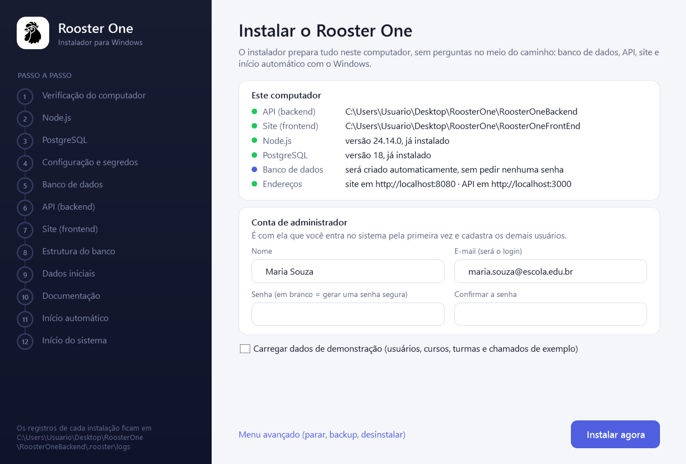
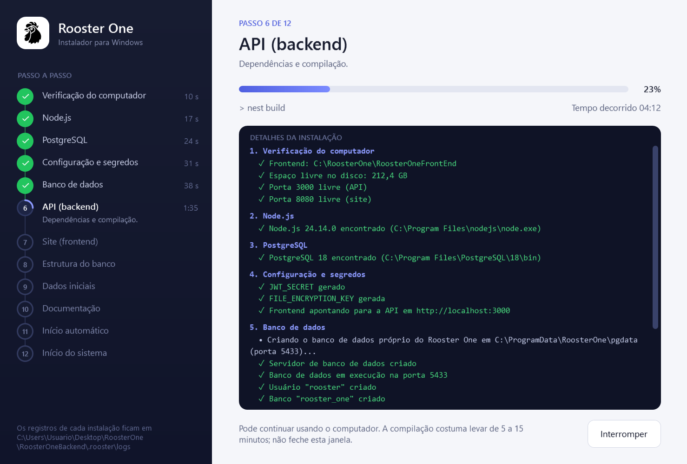
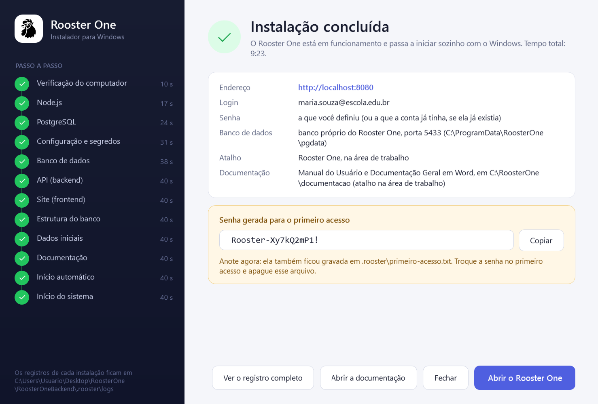

# Instalador para Windows

O instalador automatiza a implantação do Rooster One em um computador Windows, em modo de produção e sem
dependência de Docker: instala os pré-requisitos, cria o banco sem pedir nenhuma senha, gera a configuração, compila
os dois projetos, prepara os dados iniciais (catálogo de permissões e conta de administrador), gera a documentação em
Word (Manual do Usuário e Documentação Geral) e registra a API e o site para iniciarem automaticamente com o Windows. Destina-se a computadores de avaliação, laboratório ou servidor
local; a implantação em servidor Linux continua descrita em `04-deploy.md`.

A instalação tem um **único ponto de entrada**: o `INSTALAR.exe` do pacote de instalação (seção "Pacote de
instalação") ou, diretamente nos repositórios, o `INSTALAR.bat`. Os dois abrem a mesma tela e executam os mesmos
passos; não há outro script de criação de banco, de usuário administrador ou de início do sistema a executar antes ou
depois deles.

Arquivos (repositório do backend):

| Arquivo | Função |
|---|---|
| `scripts/instalador/INSTALAR.bat` | Ponto de entrada: solicita a elevação de administrador e abre a tela do instalador |
| `scripts/instalador/instalador-tela.ps1` | Tela do instalador (WPF): formulário inicial, passo a passo, andamento e resultado |
| `scripts/instalador/instalador.ps1` | Motor da instalação e menu de console (Windows PowerShell 5.1 ou superior) |
| `scripts/instalador/montar-pacote.ps1` | Gera o pacote de instalação: pasta com o `INSTALAR.exe`, os dois repositórios e os instaladores do Node.js e do PostgreSQL |
| `scripts/preparar-base.ts` | Catálogo de módulos e permissões, status de chamado e conta de administrador (idempotente) |
| `scripts/instalador/instaladores/` | Opcional: instaladores do Node.js (`node-*.msi`) e do PostgreSQL da EDB (`postgresql-*.exe`) para uso sem internet |
| `documentacao/` (gerada, ao lado dos repositórios) | Manual do Usuário e Documentação Geral em Word, gerados na instalação |
| `.rooster/` (gerada) | Configuração da instalação, lançador dos serviços, logs e, se for o caso, a senha gerada do primeiro acesso |
| `C:\ProgramData\RoosterOne\` (gerada) | Banco de dados próprio do Rooster One (`pgdata`), quando criado pelo instalador |

## Pré-requisitos

- Windows 10 ou 11 (ou Windows Server 2019+), 64 bits, com conta de administrador.
- Os dois repositórios lado a lado na mesma pasta (por exemplo, `TCC\RoosterOneBackend-main` e
  `TCC\RoosterOneFrontEnd-main`). O instalador localiza o frontend pela pasta cujo nome começa com
  `RoosterOneFront`.
- Internet, para a instalação do Node.js e do PostgreSQL pelo `winget`, **ou** os instaladores colocados em
  `scripts/instalador/instaladores` (ver `LEIAME.txt` na pasta). Com os dois programas já instalados, a internet é
  usada apenas pelo `npm ci`.
- Cerca de 5 GB livres em disco. As portas 3000 (API) e 8080 (site) são as preferidas; se estiverem ocupadas por
  outro programa, o instalador escolhe sozinho a próxima porta livre e informa a troca.

## Tela do instalador

Duplo clique em `scripts\instalador\INSTALAR.bat` e confirmação da elevação de administrador.

A tela inicial mostra o que foi encontrado no computador (pastas, Node.js, PostgreSQL e banco) e pede somente os
dados da **conta de administrador**: nome, e-mail (o login) e senha. Com a senha em branco, o instalador gera uma
senha segura, exibida ao final e gravada em `.rooster\primeiro-acesso.txt`. A opção **Carregar dados de
demonstração** carrega o seed de exemplo quando o banco está vazio; marcada, o e-mail do administrador passa a ser
opcional, pois o seed já traz um administrador de exemplo. Depois de **Instalar agora**, nenhuma outra pergunta é
feita.

Durante a instalação, a coluna da esquerda apresenta o **passo a passo**: os passos concluídos (com a duração de
cada um), o passo em andamento e os que faltam. A área principal mostra o passo atual, a barra de progresso geral, o
tempo decorrido e os detalhes de cada operação, inclusive a saída do `npm` e do Prisma. O mesmo registro é gravado em
`.rooster\logs\instalacao-<data>-<hora>.log`.

Ao final, a tela informa o endereço, o login, a senha gerada (se houver) e o banco utilizado, e oferece o botão
**Abrir o Rooster One**. Em caso de falha, indica o passo e a mensagem do erro, com as opções **Tentar novamente**
(os passos já concluídos são conferidos de novo rapidamente; nada do que foi feito se perde) e **Ver o registro
completo**.

Com o sistema já instalado, a mesma tela oferece **Atualizar ou reparar** (ver "Atualização do sistema") e **Abrir o
Rooster One**. Para ver a tela sem instalar nada: `powershell -ExecutionPolicy Bypass -File
scripts\instalador\instalador-tela.ps1 -Demo`.

## Passos da instalação

1. **Verificação do computador**: localiza o frontend, confere o espaço em disco e as portas (porta ocupada pelo
   próprio Rooster One, por exemplo o servidor de desenvolvimento, é liberada; porta ocupada por outro programa é
   trocada pela próxima livre) e encerra o sistema, se estiver em execução.
2. **Node.js**: mantém a versão instalada, se for a 20 ou superior; caso contrário, instala a versão LTS (pasta
   `instaladores` ou `winget install OpenJS.NodeJS.LTS`).
3. **PostgreSQL**: mantém a instalação existente (`C:\Program Files\PostgreSQL\<versão>`); caso não exista,
   instala o PostgreSQL 16 em modo silencioso, com senha aleatória para o superusuário `postgres`, guardada em
   `.rooster\postgres-superusuario.xml`, protegida pelo Windows (DPAPI: legível apenas pelo usuário que instalou).
4. **Configuração e segredos**: cria o `.env` do backend a partir do `.env.example`, se ausente, e gera
   `JWT_SECRET` e `FILE_ENCRYPTION_KEY` aleatórios quando ausentes ou com o valor de exemplo. **Segredos existentes
   nunca são substituídos**: a troca da `FILE_ENCRYPTION_KEY` tornaria ilegíveis os arquivos já enviados. Define
   `PORT` e `FRONTEND_URL` no backend e `VITE_API_URL` no frontend, conforme as portas.
5. **Banco de dados**: deixa o banco pronto e o `DATABASE_URL` gravado, **sem pedir a senha do superusuário**. A
   decisão segue esta ordem:
   1. a conexão do `.env` já funciona: o banco existente é mantido;
   2. existe a pasta `banco-local` ao lado dos repositórios (banco de desenvolvimento) e o `.env` aponta para ela:
      o instalador passa a iniciá-la com o Windows e a mantém, com os dados;
   3. o PostgreSQL foi instalado pelo próprio instalador (passo 3): o usuário `rooster` e o banco `rooster_one` são
      criados no servidor principal, na porta 5432;
   4. caso geral (PostgreSQL já instalado, com senha desconhecida): o instalador cria um **banco próprio do Rooster
      One**, um cluster exclusivo em `C:\ProgramData\RoosterOne\pgdata`, na primeira porta livre a partir da 5433,
      registrado como o serviço do Windows `RoosterOnePostgres` (início automático). A senha do superusuário desse
      cluster é gerada e guardada em `C:\ProgramData\RoosterOne\superusuario.bin`, protegida pelo Windows (DPAPI, no
      escopo da máquina). Os bancos e a senha do PostgreSQL já instalado não são tocados.

   O banco próprio fica fora da pasta do código de propósito: substituir a pasta do repositório em uma atualização
   não leva os dados junto.
6. **API (backend)**: `npm ci`, `prisma generate` e `npm run build`.
7. **Site (frontend)**: `npm ci` e `npm run build` com `NITRO_PRESET=node-server`. Sem esse ajuste, o build gera
   pacote para Cloudflare Workers (padrão do template), que não executa no Node.js local; com ele, gera servidor Node
   em `.output/server/index.mjs`.
8. **Estrutura do banco**: `prisma migrate deploy`.
9. **Dados iniciais**: carrega os dados de demonstração, se solicitados e se o banco estiver vazio, e executa
   `scripts/preparar-base.ts`, que garante o catálogo de módulos e permissões (`src/common/catalogo-permissoes.ts`),
   os status de chamado do Desk e a conta de administrador, com todas as permissões. O script é idempotente: nada é
   apagado, e a senha de um administrador que já existe nunca é alterada. A senha informada na tela é passada ao
   script por variável de ambiente, nunca pela linha de comando.
10. **Documentação**: gera, em Word, o Manual do Usuário (`docs/manual-usuario/gerar-manual.js`, a partir de
    `manual.json` e das capturas de tela) e a Documentação Geral (`docs/gerar-documentacao.js`, a partir da árvore
    `docs/` dos dois repositórios, dos diagramas e do `CHANGELOG.md`) na pasta `documentacao`, ao lado dos
    repositórios (no pacote de instalação, ao lado do `INSTALAR.exe`), e cria o atalho **Rooster One - Documentação**
    na área de trabalho pública. Os geradores usam as dependências instaladas no passo 6. A falha na geração é
    informada como aviso e não interrompe a instalação, pois não afeta o funcionamento do sistema; a documentação
    pode ser gerada depois com `npm run manual` e `npm run documentacao`. O sumário de cada documento é atualizado ao
    abri-lo no Word. A tela final oferece o botão **Abrir a documentação**.
11. **Início automático**: gera `.rooster\iniciar-servico.ps1` e registra no Agendador de Tarefas as tarefas
    **Rooster One - API** e **Rooster One - Site**, executadas como `SYSTEM` na inicialização do Windows, sem limite
    de tempo. O lançador executa o Node.js em laço: em caso de queda, o processo é reiniciado em 5 segundos. A API
    roda com `NODE_ENV=production` (CORS restrito a `FRONTEND_URL` e Swagger desativado, salvo
    `SWAGGER_ENABLED=true`). Os logs ficam em `.rooster\logs\api.log` e `site.log`, alternados ao passar de 10 MB.
    Cria também o atalho **Rooster One** na área de trabalho pública.
12. **Início do sistema**: inicia as duas tarefas e aguarda a resposta de `GET /health` e da tela de login. Sem
    resposta, a instalação é dada como não concluída, e o fim do log correspondente é exibido.

A instalação pode ser repetida sobre uma instalação existente: dados, segredos e banco são preservados, e somente a
compilação, as migrations e a conferência dos dados iniciais são refeitas.

## Pacote de instalação

Para instalar em outro computador, utiliza-se o pacote de instalação: uma pasta autocontida, gerada a partir dos
repositórios por `scripts/instalador/montar-pacote.ps1` (PowerShell comum, sem administrador). Por padrão, a pasta
`instalador` é criada ao lado dos dois repositórios:

| Item | Conteúdo |
|---|---|
| `INSTALAR.exe` | Executável que pede a elevação de administrador e abre a tela do instalador. Com o argumento `menu`, abre o menu de console; outros argumentos são repassados ao motor (`INSTALAR.exe -Acao Status`) |
| `RoosterOneBackend\` e `RoosterOneFrontEnd\` | Cópia dos repositórios, sem `node_modules`, compilação, `.env`, `uploads`, backups, dados da instalação e histórico do Git |
| `pacotes\` | Instaladores oficiais do Node.js LTS (`node-<versão>-x64.msi`, de nodejs.org, com o SHA-256 conferido contra a lista oficial) e do PostgreSQL (`postgresql-<versão>-1-windows-x64.exe`, da EnterpriseDB, com a assinatura digital conferida) |
| `LEIA-ME.txt` | Instruções de uso |

Uso: copiar a pasta inteira para o local definitivo do sistema (por exemplo, `C:\RoosterOne`), pois o sistema é
instalado e executado a partir dela, e abrir o `INSTALAR.exe`. O pacote dispensa o `winget` e a internet para o
Node.js e o PostgreSQL; a internet continua necessária para o `npm ci` (bibliotecas do sistema). O `INSTALAR.exe`
não é assinado digitalmente, e o Windows pode exibir o aviso do SmartScreen na primeira abertura ("Mais informações"
→ "Executar assim mesmo").

O executável é compilado pelo próprio script com o compilador C# do .NET Framework 4, presente no Windows; o código
fica em `montar-pacote.ps1`. O script pode ser repetido: o código é espelhado, e os instaladores já baixados não são
baixados de novo. Parâmetros: `-Destino` (pasta do pacote), `-VersaoNode` (padrão `latest-v24.x`), `-VersaoPostgres`
(padrão `18.4`) e `-SemDownload` (atualiza somente o código e o executável). O pacote gerado em 11/11/2026 tem cerca
de 430 MB, dos quais 360 MB correspondem ao instalador do PostgreSQL.

## Instalação sem internet (PostgreSQL e Node.js locais)

Para que a instalação dispense o `winget`, basta baixar o instalador do PostgreSQL para Windows da EDB
(`postgresql-<versão>-windows-x64.exe`) e, se necessário, o do Node.js LTS (`node-<versão>-x64.msi`), e colocá-los,
sem renomear, em `scripts/instalador/instaladores`. Também são aceitos na pasta `scripts/instalador`, na raiz do
backend, na pasta que contém os dois repositórios ou na subpasta `pacotes` dela (estrutura do pacote de instalação);
havendo mais de um, é utilizado o de versão mais recente. Os
arquivos têm prioridade sobre o `winget` e são ignorados quando o programa já está instalado. Os executáveis não são
versionados no Git.

## Menu de console

O link **Menu avançado** da tela, ou `INSTALAR.bat menu`, abre o menu de console:

| Opção | Ação |
|---|---|
| 1. Instalação completa | Os mesmos passos da tela, com as perguntas (administrador e demonstração) feitas no console |
| 2. Iniciar o sistema | Inicia o banco gerenciado, as tarefas da API e do site, aguarda a resposta de ambos e abre o navegador |
| 3. Parar o sistema | Encerra as tarefas e os processos do Node.js do Rooster One (o banco continua em execução) |
| 4. Ver situação | Exibe Node.js, PostgreSQL, `.env`, banco, tarefas de início automático e a resposta da API e do site |
| 5. Verificar pré-requisitos | Igual à situação, acrescida de `winget`, portas e espaço em disco; não altera nada |
| 6. Fazer backup | Executa `scripts/backup.ps1` (banco e arquivos) para a pasta `backups` |
| 7. Restaurar dados de demonstração | Apaga todos os dados e carrega o seed de demonstração (exige digitar `APAGAR`) |
| 8. Desinstalar | Remove o início automático e o atalho; opcionalmente exclui o banco criado pelo instalador |

As mesmas ações podem ser executadas diretamente: `INSTALAR.bat -Acao Status` ou, em PowerShell como administrador,
`.\scripts\instalador\instalador.ps1 -Acao Status` (ações: `Instalar`, `Iniciar`, `Parar`, `Status`, `Verificar`,
`Backup`, `Demonstracao` e `Desinstalar`).

## Atualização do sistema

1. Atualização do código dos dois repositórios (`git pull` ou substituição das pastas, preservando o `.env` do
   backend e as pastas `uploads` e `.rooster`).
2. `INSTALAR.bat` → **Atualizar ou reparar**, que encerra o sistema, recompila, aplica as novas migrations, confere o
   catálogo de permissões e reinicia. A conta de administrador não é solicitada nem alterada.

## Desinstalação

A opção 8 do menu remove as tarefas de início automático e os atalhos (sistema e documentação). Quanto ao banco: o banco próprio do Rooster One
é excluído apenas mediante confirmação (com o serviço `RoosterOnePostgres`); o banco local adotado deixa de iniciar
com o Windows, e a pasta é mantida; o banco criado no PostgreSQL instalado pelo instalador é excluído mediante
confirmação; um banco que não foi criado pelo instalador nunca é alterado. Código-fonte, `.env`, `uploads`,
`backups` e a pasta `documentacao` são mantidos. Node.js e PostgreSQL permanecem instalados e podem ser removidos em "Aplicativos instalados"
do Windows.

## Limitações

- O site é servido em `http://localhost`; o acesso por outros computadores da rede exige ajustar `VITE_API_URL`
  (frontend) e `FRONTEND_URL`/`CORS_ORIGINS` (backend) para o endereço da máquina, recompilar o frontend e liberar
  as portas no firewall do Windows.
- Não há HTTPS: o instalador destina-se a uso local ou em rede interna confiável (ver `04-deploy.md`).
- O backup não é agendado automaticamente; utilize a opção 6 periodicamente ou agende `scripts/backup.ps1`.
- A cópia do `.env` do backend deve acompanhar os backups: sem a `FILE_ENCRYPTION_KEY`, os arquivos enviados não
  podem ser lidos (ver `06-backup-e-recuperacao.md`).
- O registro do serviço `RoosterOnePostgres`, das tarefas de início automático e a adoção da pasta `banco-local`
  exigem privilégio de administrador e, até 10/11/2026, não foram exercitados em teste automatizado; os demais
  passos (criação do banco próprio, migrations, dados iniciais e compilação) foram verificados em área temporária.

## Solução de problemas

| Sintoma | Verificação |
|---|---|
| A instalação parou em um passo | A tela indica o passo e o erro; o registro completo está em `.rooster\logs\instalacao-*.log`. Corrigida a causa, use **Tentar novamente** |
| A API não responde após iniciar | `.rooster\logs\api.log`; causas comuns: banco parado (opção 4 do menu) ou `.env` incompleto |
| O site não responde | `.rooster\logs\site.log`; confirme que a compilação gerou `.output\server\index.mjs` no frontend |
| O banco não inicia com o Windows | Serviço `RoosterOnePostgres` em "Serviços" (ou a tarefa **Rooster One - Banco**, usada quando o serviço não pôde ser criado); log em `C:\ProgramData\RoosterOne\pgdata\postgres.log` ou na pasta `log` do cluster |
| "Acesso negado" ao executar `.ps1` diretamente | Utilize `INSTALAR.bat`, que aplica `-ExecutionPolicy Bypass` e solicita elevação |
| Nenhum administrador para entrar no sistema | Repita a instalação informando nome e e-mail do administrador, ou execute `scripts/preparar-base.ts` com `ROOSTER_ADMIN_EMAIL` |
| Porta ocupada | A instalação troca a porta sozinha e informa; a opção 5 do menu identifica o programa que a ocupa |
